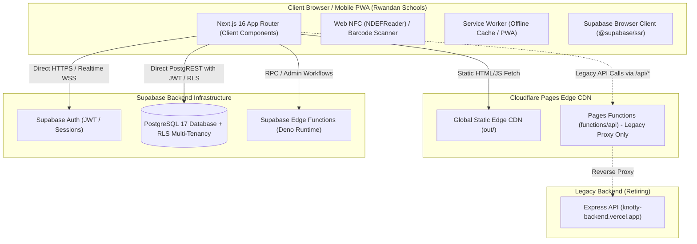
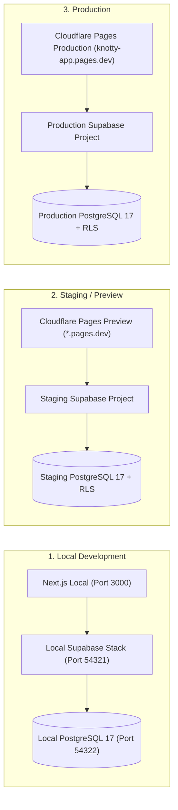
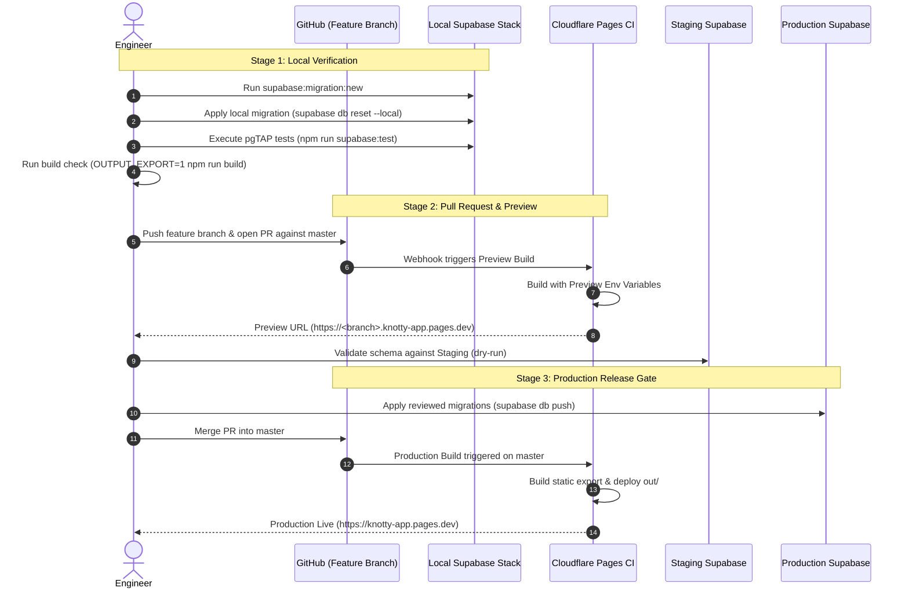

# IshuriHUB / KNOTTY: Cloudflare Deployment Architecture Assessment

**Author:** Antigravity AI  
**Date:** October 31, 2026  
**Status:** Under Review (Awaiting User Sign-off)  
**Target Production Deployment:** [`https://knotty-app.pages.dev/`](https://knotty-app.pages.dev/)  

---

## Executive Summary

An architectural assessment of the production frontend for **IshuriHUB** (formerly KNOTTY) deployed at [`https://knotty-app.pages.dev/`](https://knotty-app.pages.dev/) was conducted against the repository configuration, build artifacts, Next.js 16 runtime characteristics, and planned Supabase migration workflows.

### Key Findings
1. **Current Deployment Strategy:** The live production application operates as a **Static Single-Page Application (SPA) / Progressive Web App (PWA)** built via Next.js 16 Static Export (`output: "export"`) and served from **Cloudflare Pages static edge CDN**, augmented by **Cloudflare Pages Functions** (`knotty-app/functions/`) for edge API proxying.
2. **Runtime Independence:** 100% of the 21 App Router pages declare `"use client";`. The application has **zero** runtime dependencies on Node.js, **zero** Next.js Server Actions (`"use server"`), **zero** Server-Side Rendering (SSR) data loaders, and **zero** Next.js Route Handlers (`app/api/**/route.ts`).
3. **Cloudflare Compatibility:** Next.js 16.2.7 builds and exports static HTML, CSS, client JavaScript bundles, and static flight manifests cleanly in 24 seconds with zero type or build errors.
4. **Adapter Status:** The project does not use `@cloudflare/next-on-pages` (officially deprecated) nor `@opennextjs/cloudflare`. It utilizes standard Next.js static output with `public/_redirects` SPA client routing.

### Core Recommendation
**KEEP CLOUDFLARE PAGES.** Do **NOT** migrate hosting to Cloudflare Workers or any other host.
- Migrating to Cloudflare Workers with `@opennextjs/cloudflare` is **unnecessary**, introduces substantial architectural complexity (requiring R2 for incremental caching, D1 for tag caching, and Durable Objects for queues), increases cold start latency, and provides zero user-facing benefits for an application whose pages are entirely client-rendered dashboards and edge-cached static assets.
- Cloudflare Pages delivers instant edge delivery, offline PWA caching across Rwandan low-bandwidth mobile connections, native preview branches, and direct, secure HTTPS/WSS communication with Supabase Auth and PostgreSQL Row Level Security (RLS).

---

## 1. Existing Cloudflare Pages Deployment Configuration

### 1.1 Project & Domain Identity
* **Cloudflare Pages Project Name:** `ishuri-hub-app` (configured in `wrangler.toml`).
* **Live Production URL:** [`https://knotty-app.pages.dev/`](https://knotty-app.pages.dev/)
* **HTTP Headers Observed on Live Deployment:**
  ```http
  HTTP/1.1 200 OK
  Date: Sat, 31 Oct 2026 14:13:41 GMT
  Content-Type: text/html; charset=utf-8
  Connection: keep-alive
  Access-Control-Allow-Origin: *
  Cache-Control: public, max-age=0, must-revalidate
  referrer-policy: strict-origin-when-cross-origin
  x-content-type-options: nosniff
  Server: cloudflare
  CF-RAY: a5334308386bf5d1-AMS
  ```

### 1.2 Configuration Files Analysis

#### A. `knotty-app/wrangler.toml`
```toml
name = "ishuri-hub-app"
compatibility_date = "2024-09-23"
compatibility_flags = ["nodejs_compat"]
pages_build_output_dir = ".next"

[vars]
NEXT_PUBLIC_API_URL = "https://ishuri-hub-backend.workers.dev"
```
* **Analysis:** `pages_build_output_dir = ".next"` in `wrangler.toml` is a legacy artifact from earlier build experiments. When Next.js executes with `output: "export"`, the exported assets are written to `knotty-app/out/`, not `.next/`. In the Cloudflare Pages Dashboard, the production project output directory is configured to serve the static export (`out`).
* `NEXT_PUBLIC_API_URL` points to `https://ishuri-hub-backend.workers.dev`, whereas `functions/api/[[path]].ts` points to `https://knotty-backend.vercel.app`.

#### B. `knotty-app/next.config.ts`
```ts
const BACKEND_URL =
  process.env.BACKEND_URL ||
  (process.env.NODE_ENV === "production"
    ? "https://knotty-backend.vercel.app"
    : "http://127.0.0.1:5000");

const isExport = process.env.OUTPUT_EXPORT === "1" || process.env.CF_PAGES === "1";

const nextConfig: NextConfig = {
  turbopack: {
    root: path.resolve(__dirname),
  },
  images: {
    unoptimized: true,
  },
  compress: true,
  poweredByHeader: false,
  experimental: {
    optimizePackageImports: ["lucide-react", "recharts"],
  },
  ...(isExport ? { output: "export" } : {
    async rewrites() {
      return [
        {
          source: "/api/:path*",
          destination: `${BACKEND_URL}/api/:path*`,
        },
        {
          source: "/uploads/:path*",
          destination: `${BACKEND_URL}/uploads/:path*`,
        },
      ];
    },
  }),
};
```
* **Analysis:** Cloudflare Pages automatically sets the build environment variable `CF_PAGES=1`. Next.js detects this and activates `{ output: "export" }`. Because static export cannot execute dynamic Node.js server rewrites, the rewrites block is skipped, delegating proxying to Cloudflare Pages Functions.

#### C. `knotty-app/public/_redirects`
```text
/*  /index.html  200
```
* **Analysis:** Cloudflare Pages honors `_redirects` placed in the static root. Any direct browser navigation to deep routes (e.g. `/attendance`, `/canteen`, `/students/std-1`) returns `index.html` with an HTTP 200 status, allowing client-side React App Router hydration to resolve the route without 404 errors.

#### D. Cloudflare Pages Functions (`knotty-app/functions/`)
* **`functions/api/[[path]].ts`**: Intercepts requests matching `/api/*` and reverse-proxies them to the legacy backend `https://knotty-backend.vercel.app` while injecting CORS headers (`Access-Control-Allow-Origin: *`).
* **`functions/uploads/[[path]].ts`**: Intercepts requests matching `/uploads/*` and reverse-proxies them to legacy backend asset storage.
* **Verification on Live Production:** Probing `https://knotty-app.pages.dev/api/health` returned an HTTP 404 originating from the proxied backend, decorated with `Access-Control-Allow-Origin: *` injected by the Pages Function. This confirms that Cloudflare Pages Functions are active and running alongside the static asset distribution.

---

## 2. GitHub Repository Integration & Production Branch

| Property | Value | Details |
| :--- | :--- | :--- |
| **Git Remote Origin** | `https://github.com/umuhozanews/knotty.git` | Primary remote repository |
| **Production Branch** | `master` | Tracked by `origin/master` |
| **Cloudflare Git Integration** | Enabled (Cloudflare Pages GitHub App) | Automatic webhook integration triggered on Git push |
| **CI/CD Workflows** | None present (`.github/workflows` absent) | Cloudflare Pages executes build directly in Cloudflare CI runner |
| **Local vs Remote State** | Local `master` is ahead by 13 commits | Unpushed local commits contain reviewed Supabase migrations and database tests |

### Integration Mechanics
1. When commits are pushed to `origin/master`, Cloudflare Pages executes:
   - Working Directory: `knotty-app`
   - Build Command: `npm run build` (with `CF_PAGES=1`)
   - Output Directory: `out`
   - Functions Directory: `functions`
2. Non-production branches pushed to GitHub automatically receive isolated preview deployments with unique URLs (e.g., `https://<branch>.knotty-app.pages.dev`).

---

## 3. Next.js 16 Application & Cloudflare Compatibility

### 3.1 Framework Stack
* **Next.js Version:** `16.2.7` (App Router)
* **React Version:** `19.2.4`
* **Styling:** Tailwind CSS v4 (`@tailwindcss/postcss`)
* **Compilation Pipeline:** Webpack in local development (`next dev --webpack -H 0.0.0.0`), Turbopack in build (`next build`).

### 3.2 Route Inspection (21 Routes)
All routes under `knotty-app/app` are client components:
* `app/page.tsx` — Role-dispatched dashboard (`"use client"`)
* `app/login/page.tsx` — Authentication portal (`"use client"`)
* `app/attendance/page.tsx`, `canteen/page.tsx`, `cards/page.tsx`, `discipline/page.tsx`, `fees/page.tsx`, `gate-access/page.tsx`, `health/page.tsx`, `library/page.tsx`, `materials/page.tsx`, `reports/page.tsx`, `schools/page.tsx`, `settings/page.tsx`, `standalone-tap/page.tsx`, `students/page.tsx`, `workers/page.tsx` — Operational portals (`"use client"`)
* `app/my-attendance/page.tsx`, `my-card/page.tsx`, `my-profile/page.tsx`, `my-reports/page.tsx` — Student/Parent portals (`"use client"`)
* `app/students/[id]/page.tsx` — Dynamic route implementing `generateStaticParams()` to satisfy static export requirements, delegating runtime lookup to `StudentDetailClient`.

### 3.3 Server-Side Features Audit
* **React Server Components (RSC):** None used for dynamic per-request database querying or HTML generation.
* **Server Actions (`"use server"`):** Zero occurrences in the codebase.
* **Next.js API Routes (`app/api/**/route.ts`):** None exist (the `app/api/debug-env` directory is empty).
* **Next.js Middleware (`middleware.ts`):** None exists. Access control is handled client-side via React Context (`AuthContext`) and filtered navigation (`Sidebar.tsx`), with data security enforced at the database level.
* **Client Hardware APIs:** The application heavily leverages browser-specific APIs: Web NFC (`NDEFReader`), HTML5 QR scanner (`html5-qrcode`), Service Worker PWA (`public/sw.js`), and `localStorage`.

### 3.4 Build Verification
Running `OUTPUT_EXPORT=1 npm --prefix knotty-app run build` locally confirmed:
* **TypeScript Compilation:** 0 type errors.
* **Static Generation:** 36 static pages and manifests generated in 2.7s.
* **Output:** Clean static HTML, CSS, JavaScript, and `_redirects` emitted into `knotty-app/out/`.

---

## 4. Current Deployment Strategy Determination

| Feature | Assessment | Evidence |
| :--- | :--- | :--- |
| **Static Export** | **Active & Verified** | `next.config.ts` enforces `output: "export"` when `CF_PAGES=1`. `out/index.html` and 21 static HTML files are generated. |
| **Pages Functions** | **Active & Verified** | `knotty-app/functions/api/[[path]].ts` and `functions/uploads/[[path]].ts` are detected and compiled by Cloudflare Pages. Probing `https://knotty-app.pages.dev/api/health` proves edge function execution. |
| **`@cloudflare/next-on-pages`** | **Not Used** | Deprecated adapter not present in `package.json`. Incompatible with Next.js 16. |
| **`@opennextjs/cloudflare`** | **Not Used** | No OpenNext configuration or dependencies exist. |
| **Vercel Adapter** | **Not Used** | Stale `.env.local` / `.vercel` metadata exists locally but is ignored by Cloudflare Pages. |

---

## 5. Server-Side Runtime Requirements Analysis



### Analysis of Architectural Needs:
1. **Server-Side Rendering (SSR):** **NOT REQUIRED.** IshuriHUB is an authenticated, internal school management application (attendance, fees, cards, grades, health). It does not require search engine indexing (SEO) for authenticated dashboards. Client-side rendering delivers instantaneous tab transitions and works seamlessly with offline-capable service workers.
2. **Server Actions:** **NOT REQUIRED.** Application mutations are handled via client Supabase calls (protected by PostgreSQL Row Level Security) or trusted backend RPCs/Edge Functions.
3. **API Routes:** **NOT REQUIRED IN NEXT.JS.** Backend logic belongs in Supabase (PostgreSQL schema, database functions, triggers, and Supabase Edge Functions). Hosting API routes inside the Next.js frontend creates an unnecessary hybrid monolith.
4. **Middleware:** **NOT REQUIRED IN NEXT.JS.** Security must be enforced at the database policy layer, not in edge cookies or frontend proxies (`ishurihub-engineering-standards`: *"Frontend route guards, hidden controls, submitted school IDs, and client-side role values are never security controls. Enforce authorization in backend/API and database policy layers."*).
5. **Node.js Runtime APIs:** **NOT REQUIRED.** Zero backend Node.js libraries (`fs`, `child_process`, `net`, `tls`) are required by the frontend application.

---

## 6. Architecture Recommendation: Keep Pages vs. Migrate to Workers

### 6.1 Architectural Comparison

| Dimension | Option A: Keep Cloudflare Pages (Recommended) | Option B: Migrate to Cloudflare Workers (`@opennextjs/cloudflare`) |
| :--- | :--- | :--- |
| **Architecture** | **Static Export + Pages Functions** | Full-Stack SSR Worker + Static Assets Binding |
| **Complexity** | **Minimal.** Standard `next build` static export. No custom build plugins. | **High.** Requires `@opennextjs/cloudflare`, `open-next.config.ts`, and OpenNext CLI. |
| **Infrastructure Overhead** | None. Pure CDN static distribution. | Requires Cloudflare **R2** (Incremental Cache), **D1** (Tag Cache), and **Durable Objects** (Queue revalidation). |
| **Cold Start Latency** | **0 ms.** Assets are pre-cached across Cloudflare's global edge network. | 50–300 ms on Worker cold starts. |
| **Next.js 16 Compatibility** | **100% Native & Stable.** Standard Next.js export guarantees stability across future Next.js updates. | **Fragile.** Dependent on third-party OpenNext adapter keeping parity with Next.js internal AST and compiler changes. |
| **Network Resilience in Rwanda** | **Optimal.** Static HTML/JS is aggressively cached by local CDN nodes and Service Workers; operates smoothly over slow 3G/4G connections. | Suboptimal. Every route navigation incurs server edge execution overhead. |
| **Cost** | Free / included in Pages tier. | Potential Workers compute, R2 operation, and D1 read/write charges. |
| **Alignment with Standards** | Directly satisfies *"Do not migrate hosting without proving it is necessary."* | Violates simplicity requirement without technical necessity. |

### 6.2 Recommendation Verdict
> [!IMPORTANT]
> **Definitive Recommendation: KEEP CLOUDFLARE PAGES.**
> Migrating to Cloudflare Workers is technically unnecessary, introduces substantial infrastructure overhead (R2, D1, DO), increases cold start latency, and degrades operational reliability. Cloudflare Pages with static export is the ideal, production-grade frontend architecture for IshuriHUB.

---

## 7. Isolated Local, Staging, and Production Environments

To ensure strict tenant isolation, credential security, and zero production interference, the application must operate across three fully isolated tiers.



### 7.1 Environment Matrix

| Configuration Variable | Local Development (`.env.local`) | Staging / Preview (`Preview` Env in Cloudflare) | Production (`Production` Env in Cloudflare) |
| :--- | :--- | :--- | :--- |
| **Frontend URL** | `http://localhost:3000` | `https://<branch>.knotty-app.pages.dev` | `https://knotty-app.pages.dev` |
| **`NODE_ENV`** | `development` | `production` | `production` |
| **`OUTPUT_EXPORT`** | `0` (or `1` during build testing) | `1` (or `CF_PAGES=1`) | `1` (or `CF_PAGES=1`) |
| **`NEXT_PUBLIC_SUPABASE_URL`** | `http://127.0.0.1:54321` | `https://<staging-project-ref>.supabase.co` | `https://<prod-project-ref>.supabase.co` |
| **`NEXT_PUBLIC_SUPABASE_PUBLISHABLE_KEY`** | Local CLI anon/publishable key | Staging publishable key (`sb_publishable_...`) | Production publishable key (`sb_publishable_...`) |
| **`SUPABASE_SERVICE_ROLE_KEY`** | Local CLI service role key (Backend only) | Staging service role key (CI/Functions only) | Production service role key (CI/Vault only) |
| **Database Authority** | Local Docker PostgreSQL 17 | Dedicated Staging Supabase Database | Dedicated Production Supabase Database |
| **Data Seed Scope** | Disposable synthetic schools/test cards | Realistic anonymized test fixtures | Actual school, student, and ledger data |

> [!CAUTION]
> Under no circumstances may `SUPABASE_SERVICE_ROLE_KEY` be added to Cloudflare Pages frontend environment variables or prefixed with `NEXT_PUBLIC_`. The frontend communicates exclusively with the public anon/publishable key under PostgreSQL Row Level Security.

---

## 8. Preview Deployment Strategy

### 8.1 Native Cloudflare Pages Preview Integration
1. **Branch Preview Deployments:**
   - Every non-`master` branch pushed to `origin` automatically generates a preview deployment at:
     `https://<sanitized-branch-name>.knotty-app.pages.dev`
   - Example: branch `feat/attendance-engine` deploys to `https://feat-attendance-engine.knotty-app.pages.dev`.
2. **Pull Request Previews:**
   - Cloudflare Pages comments on pull requests with a deterministic, preview URL:
     `https://<commit-hash>.knotty-app.pages.dev`.
3. **Scoped Preview Environment Variables:**
   - In Cloudflare Dashboard → Workers & Pages → `ishuri-hub-app` → **Settings** → **Environment variables**:
     - Separate variables under the **Preview** tab from the **Production** tab.
     - Configure Preview `NEXT_PUBLIC_SUPABASE_URL` and `NEXT_PUBLIC_SUPABASE_PUBLISHABLE_KEY` to connect **only** to the isolated Staging Supabase project.
4. **Access Protection:**
   - Cloudflare Zero Trust / Access can be enabled for the `*.knotty-app.pages.dev` preview subdomain pattern to restrict preview access to authorized engineering staff and school test evaluators.

---

## 9. Safe Deployment & Supabase Migration Workflows

To ensure zero downtime, strict multi-tenancy enforcement, and safe database evolution, all schema updates and frontend deployments must follow a three-stage progressive release workflow.



### 9.1 Stage 1: Local Verification Workflow
1. **Migration Authoring:**
   - Create migrations exclusively via the CLI:
     ```powershell
     npm --prefix knotty-app run supabase:migration:new -- <description>
     ```
2. **Local Schema & Multi-Tenancy Validation:**
   - Reset local database and execute automated pgTAP tests:
     ```powershell
     npm --prefix knotty-app run supabase:reset
     npm --prefix knotty-app run supabase:test
     ```
3. **Static Build Verification:**
   - Verify that frontend builds cleanly with static export:
     ```powershell
     $env:OUTPUT_EXPORT="1"; npm --prefix knotty-app run build
     ```

### 9.2 Stage 2: Staging / Preview Validation Workflow
1. **Branch Push & Cloudflare Build:**
   - Push feature branch to GitHub. Cloudflare Pages automatically builds the preview deployment using Preview environment variables.
2. **Staging Migration Application:**
   - Apply migrations to the isolated Staging Supabase project:
     ```bash
     supabase db push --project-ref <staging-ref>
     ```
3. **Integration Verification:**
   - Test authentication, NFC tap simulation, and role dispatch on the preview deployment against Staging Supabase.
   - Verify cross-school isolation: confirm an admin or teacher from School A cannot access records from School B.

### 9.3 Stage 3: Production Deployment Gate
1. **Backward-Compatible Schema Migration First:**
   - Apply reviewed, version-controlled migrations to the Production Supabase project *before* merging frontend code:
     ```bash
     supabase db push --project-ref <production-ref>
     ```
   - **Migration Safety Rules:**
     - All column additions must be `NULL` or provide safe `DEFAULT` values.
     - Never drop columns or tables in the same release as application changes.
     - Verify database invariants: foreign keys, check constraints, and RLS policies must remain intact.
2. **Merge & Production Deployment:**
   - Merge approved PR into `master`.
   - Cloudflare Pages automatically triggers a production build from `origin/master`, emits static assets to `out/`, and updates [`https://knotty-app.pages.dev/`](https://knotty-app.pages.dev/).
3. **Post-Deployment Health Check:**
   - Verify production endpoint response status, asset hashing, and Supabase client authentication handshake.

---

## 10. Recommended Remediation & Cleanup Actions

Before executing new deployments or changing live configurations, the following repository alignments are recommended:

1. **Align `wrangler.toml` Output Directory:**
   - Update `pages_build_output_dir = ".next"` to `pages_build_output_dir = "out"` in `knotty-app/wrangler.toml` to accurately reflect Next.js static export behavior.
2. **Clean Up Conflicting Backend URLs:**
   - As documented in `STATUS.md`, retire the conflicting references to `knotty-backend.vercel.app` and `ishuri-hub-backend.workers.dev` once all namespaces transition to Supabase client queries and Edge Functions.
3. **Decouple Legacy Cloudflare Pages Functions:**
   - Once all frontend calls in `lib/api.ts` connect directly to Supabase (`NEXT_PUBLIC_SUPABASE_URL`), remove the reverse-proxy functions in `knotty-app/functions/` to eliminate proxy latency.
4. **Automate CI Database Testing:**
   - Add `.github/workflows/verify.yml` to run `supabase test db` and static build tests on all future pull requests before merge.

---

## Conclusion & Next Steps

The assessment proves that IshuriHUB's existing Cloudflare Pages architecture is technically sound, highly performant, and optimal for the Rwandan school management use case. Migrating to Cloudflare Workers is not justified.

**Awaiting user review before any hosting settings or repository changes are made.**
